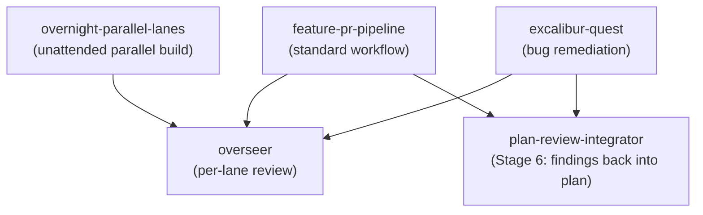
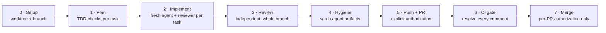

# Overseer for OpenCode

Agent skills for review-gated coding workflows: adversarial review panels, unattended parallel build lanes, bug-remediation quests, and a standardized feature-to-PR pipeline. Installs into OpenCode and other compatible agentic environments.

Licensed under MIT.

## Skills

| Skill | What it does | Reach for it when |
|---|---|---|
| `overseer` | Runs a multi-agent adversarial review panel (4–6 reviewers + judge) over code, plans, or docs | You want several independent perspectives before merging — not a single opinion |
| `plan-review-integrator` | Folds review findings back into an implementation plan with full traceability | A review produced findings that belong in the plan rather than scattered comments |
| `excalibur-quest` | Drives multi-phase bug remediation: Roundtable planning, atomic edits, issue sync | A repo has a backlog of structural bugs to work through systematically |
| `overnight-parallel-lanes` | Sets up an unattended run: one isolated worktree and one worker per lane, independent review per lane, explicit stop conditions | A milestone splits into independent workstreams and you'll be away while agents build |
| `feature-pr-pipeline` | The standard feature-to-PR workflow: plan, implement with subagent-driven TDD, independent review, hygiene pass, PR, then CI and review-comment gating | Any multi-step feature, fix, or docs change that ends as a pull request |

## How the skills fit together



`feature-pr-pipeline` is the default path for feature work. It calls on `overseer` for its review stage and `plan-review-integrator` when review findings need to go back into the plan. `overnight-parallel-lanes` and `excalibur-quest` are specialized runners on the same review machinery.

## The standard workflow



Every stage has an explicit exit gate. The pipeline stops and reports instead of merging — merging, branch deletion, force-push, and history rewrite each need separate explicit authorization naming the exact target.

## Installation

Run the included installation script to copy the skills, support files, and slash commands to your OpenCode configuration directory:

```bash
# Mac / Linux
chmod +x install.sh
./install.sh --target ~/.config/opencode

# For live development (symlinks instead of copying)
./install.sh --target ~/.config/opencode --mode symlink
```

## Usage

Once installed, restart your OpenCode session.

**Review panel** — via the registered slash command or natural phrasing:

```
> /roundtable ./src
```

```
> Run an adversarial review panel on my current implementation plan.
```

The panel produces three artifacts in your current directory:
- `review_panel_report.md` (summary and action items)
- `review_panel_process.md` (verbatim process log)
- `review_panel_report.html` (interactive dashboard)

**Standard workflow:**

```
> Use the feature-pr-pipeline workflow to implement <what> ending as a PR.
```

**Unattended lanes:**

```
> Set up overnight parallel lanes for <milestone>: <lane A>, <lane B>, <lane C>.
```

**Bug remediation:**

```
> Run an excalibur quest on issue #123.
```

## License

MIT — see [LICENSE](LICENSE).
